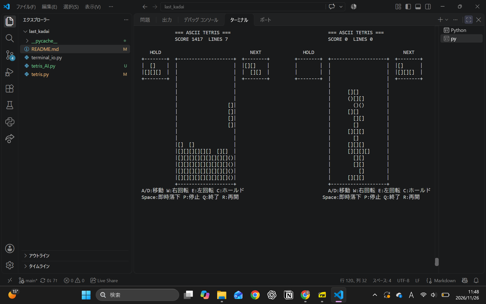

# ASCII TETRIS

今回自分で作ったのは[tetris.py]ファイルです。

[tetris_AI.py]ファイルはAIを利用して作った理解していないものなので、
評価には入れないでください。

## 1. ゲームタイトル

ASCII TETRIS（ASCIIテトリス）

## 2. ゲームの概要

Pythonを使用して制作した、ターミナル上で動作するテトリスです。

落下するブロックを移動・回転させ、横一列をそろえることでスコアを獲得します。

既存のテトリスにゴーストブロックやホールド機能を追加し、操作性を向上させました。また、プレイヤーとCPUの盤面を横に並べて表示することで、対戦できるゲームへの拡張を行いました。

## 3. 動作環境

- OS：Windows
- Python：3.14
- 使用する標準ライブラリ
  - random
  - time
  - itertools
- ターミナル操作用モジュール：terminal_io.py

外部ライブラリのインストールは不要です。

## 4. インストール方法

1. Pythonをインストールします。
2. ゲームのプログラムをダウンロードします。
3. `tetris.py` と `terminal_io.py` を同じフォルダに配置します。

## 5. 起動方法

ターミナルでプログラムが保存されているフォルダに移動し、以下のコマンドを実行します。

```bash
python tetris.py
```

## 6. 操作方法

| キー | 操作 |
|---|---|
| A / ← | 左移動 |
| D / → | 右移動 |
| W / ↑ | 右回転 |
| E | 左回転 |
| S / ↓ | 下移動 |
| C | ホールド |
| Space | 即時落下 |
| P | 一時停止 |
| R | リスタート |
| Q | ゲーム終了 |

### ゲームルール

- 横一列にブロックをそろえると、その列が消去されます。
- 一度に多くの列を消去すると、高いスコアを獲得できます。
- 消去したライン数に応じて落下速度が上昇します。
- 新しいブロックを配置できなくなるとゲームオーバーになります。
- ホールドはブロックを固定するまで1回のみ使用できます。

## 7. 追加・改良した機能

### 左回転

ブロックの相対座標を変換することで、右回転に加えて左回転できるようにしました。

### ゴーストブロック

既存の衝突判定を利用して、ブロックが落下する位置を計算し、表示する機能を追加しました。

通常のブロックは `[]`、ゴーストブロックは `()` で表示しています。

### ホールド

現在操作しているブロックを一時的に保存し、別のブロックと交換できる機能を追加しました。

変数を使って使用状況を管理し、連続してホールドできないようにしました。

### HOLD・NEXTの形状表示

保存しているブロックと次に出現するブロックを、文字ではなく実際の形状で表示するようにしました。

共通の描画メソッドを作成することで、処理の共通化を行いました。

### 2画面表示

Tetrisクラスからプレイヤー用とCPU用の2つのインスタンスを生成しました。

それぞれの描画結果を `zip_longest()` を使用して横に結合することで、2つの盤面を同時に表示できるようにしました。

### CPUの自動落下

プレイヤーとCPUの落下時間を個別に管理することで、それぞれの盤面でブロックが自動的に落下するようにしました。

## 8. 実行画面

以下はゲームの実行画面です。



## 9. 既知の問題・制限事項

- 本家テトリスとは回転や衝突時の補正仕様が異なります。
- ブロックの出現順はランダムであり、出現する種類に偏りが生じる場合があります。
- CPUは自動落下のみを行い、盤面に応じた置き方は行いません。
- ターミナルの横幅が不足すると、2画面表示が崩れる可能性があります。

## 10. クレジット

- ベースプログラム：授業で使用したASCIIテトリス
- 開発言語：Python
- 開発支援：ChatGPT

本READMEに記載した機能については、生成AIの解説や助言を参考にしながら、処理内容を理解して実装しました。

tetris_AIの方では、CPUに幅優先探索で盤面を判断してミノを置く機能を追加しました。
ただ、こちらはAIに作らせたので、完全に理解できていないです。
